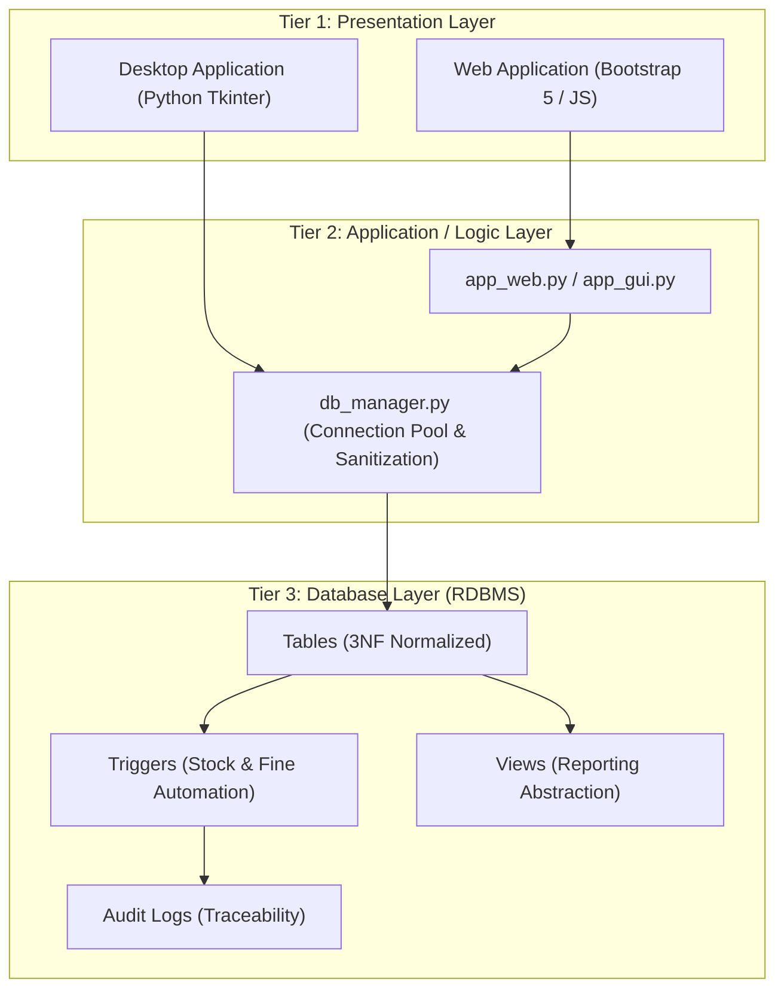
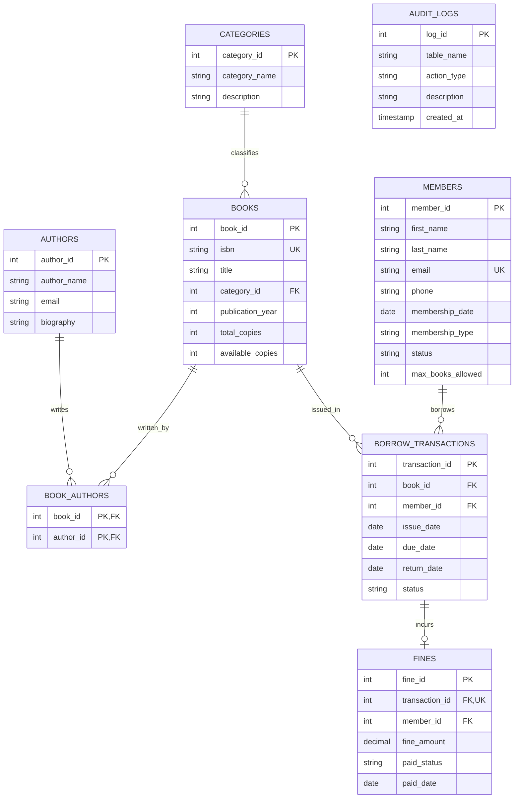

# A MINI PROJECT REPORT ON
# LIBRARY MANAGEMENT SYSTEM

**Course:** Database Management Systems (DBMS Laboratory)  
**Academic Session:** 2026 – 2027  
**Department:** Computer Science & Engineering / Information Technology  

---

### PROJECT SUBMITTED BY (TEAM MEMBERS)
1. **Atharva Doke** — Roll No: **11388**
2. **Aditya Chitimilla** — Roll No: **11385**
3. **Alroy Fernandes** — Roll No: **11393**

---

## TABLE OF CONTENTS
1. [Abstract](#1-abstract)
2. [Introduction & Problem Definition](#2-introduction--problem-definition)
3. [System Requirements Specifications](#3-system-requirements-specifications)
4. [System Architecture](#4-system-architecture)
5. [Entity-Relationship (ER) Modeling](#5-entity-relationship-er-modeling)
6. [Relational Schema & Normalization Analysis](#6-relational-schema--normalization-analysis)
7. [Data Dictionary & Table Specifications](#7-data-dictionary--table-specifications)
8. [Advanced Database Implementation](#8-advanced-database-implementation)
   - 8.1 Data Definition Language (DDL)
   - 8.2 Database Triggers
   - 8.3 Precomputed Views
   - 8.4 Stored Procedures
9. [Complex SQL Queries & Reports](#9-complex-sql-queries--reports)
10. [Test Cases & Results](#10-test-cases--results)
11. [Conclusion & Future Scope](#11-conclusion--future-scope)

---

## 1. ABSTRACT

Modern educational institutions require efficient systems to handle extensive catalogs of literary, scientific, and technical assets. Traditional manual records and flat spreadsheet systems are vulnerable to data redundancy, operational anomalies, concurrency violations, and inaccurate calculation of overdue penalties.

This mini-project presents the end-to-end design and realization of a **Relational Database Management System (RDBMS) for Library Management**. The database schema is formally normalized up to **Third Normal Form (3NF)** across eight interrelated tables. Automated business rules—including stock availability decrement/increment, borrowing quota enforcement, late return fine calculation (₹5/day), and event audit logging—are enforced directly inside the database engine via **SQL Triggers** and **Stored Procedures**. The system provides real-time reporting via **SQL Views** and is seamlessly interfaced with both a responsive Web Application and an offline Desktop Graphical User Interface (GUI).

---

## 2. INTRODUCTION & PROBLEM DEFINITION

### 2.1 Problem Statement
Manual library administration encounters several fundamental data management challenges:
1. **Redundancy & Inconsistency:** Student and book information duplicated across paper registers or spreadsheets leads to conflicting entries.
2. **Update, Insertion & Deletion Anomalies:** Deleting a borrowing transaction in a denormalized table can inadvertently delete book details.
3. **Manual Overdue Computation:** Tracking due dates manually results in billing inaccuracies and lost revenue.
4. **Lack of Concurrency Control:** Books can be issued when physical copies are exhausted if real-time inventory locking is absent.

### 2.2 Objectives of the Proposed System
- Implement a 3NF normalized relational schema that guarantees zero functional redundancy.
- Enforce strict **Referential Integrity** using foreign key constraints with `CASCADE` and `SET NULL` actions.
- Offload business rules to the database engine using **Triggers** and **Stored Procedures**.
- Abstract complex multi-table queries through reusable **Database Views**.
- Deliver a dual interface (Web and Desktop GUI) with zero external setup overhead.

---

## 3. SYSTEM REQUIREMENTS SPECIFICATIONS

### 3.1 Software Requirements
- **Operating System:** Windows 10/11, Linux, or macOS
- **RDBMS Engine:** SQLite 3 (Embedded local deployment) / MySQL 8.0+ (Enterprise deployment)
- **Programming Language:** Python 3.8+ (Utilizing standard modules `sqlite3`, `tkinter`, `http.server`)
- **Presentation Layer:** HTML5, CSS3, Bootstrap 5, JavaScript

### 3.2 Hardware Requirements
- **Processor:** Dual-core 2.0 GHz or higher
- **RAM:** Minimum 2 GB (4 GB recommended)
- **Disk Space:** 50 MB for database and application assets

---

## 4. SYSTEM ARCHITECTURE

The application adopts a standard **Three-Tier Architecture**:



---

## 5. ENTITY-RELATIONSHIP (ER) MODELING

### 5.1 Entities and Attributes
1. **CATEGORY:** `category_id` (PK), `category_name`, `description`
2. **AUTHOR:** `author_id` (PK), `author_name`, `email`, `biography`
3. **BOOK:** `book_id` (PK), `isbn` (UK), `title`, `category_id` (FK), `publication_year`, `total_copies`, `available_copies`
4. **BOOK_AUTHOR:** `book_id` (PK, FK), `author_id` (PK, FK) — *Resolves M:N relationship*
5. **MEMBER:** `member_id` (PK), `first_name`, `last_name`, `email` (UK), `phone`, `membership_date`, `membership_type`, `status`, `max_books_allowed`
6. **BORROW_TRANSACTION:** `transaction_id` (PK), `book_id` (FK), `member_id` (FK), `issue_date`, `due_date`, `return_date`, `status`
7. **FINE:** `fine_id` (PK), `transaction_id` (FK, UK), `member_id` (FK), `fine_amount`, `paid_status`, `paid_date`
8. **AUDIT_LOG:** `log_id` (PK), `table_name`, `action_type`, `description`, `created_at`

### 5.2 ER Diagram



---

## 6. RELATIONAL SCHEMA & NORMALIZATION ANALYSIS

### 6.1 First Normal Form (1NF)
- **Definition:** Every column must hold atomic values, and there must be no repeating groups.
- **Analysis:** Books frequently have multiple authors. Rather than placing comma-separated authors into a single column (e.g. `"Silberschatz, Korth"`), the relationship is decomposed into a dedicated junction table:  
  $$\text{BOOK\_AUTHORS}(\underline{\text{book\_id}, \text{author\_id}})$$  
  This guarantees that all attributes are strictly atomic, satisfying 1NF.

### 6.2 Second Normal Form (2NF)
- **Definition:** The relation must be in 1NF, and every non-prime attribute must be fully functionally dependent on the primary key (no partial dependencies on a composite candidate key).
- **Analysis:** In $\text{BOOK\_AUTHORS}$, the primary key is composite $(\text{book\_id}, \text{author\_id})$. Descriptive attributes such as `author_name` or `book_title` are kept in their respective relations ($\text{AUTHORS}$ and $\text{BOOKS}$), ensuring no non-key attribute is dependent on only part of the composite key.

### 6.3 Third Normal Form (3NF)
- **Definition:** The relation must be in 2NF, and no non-prime attribute must be transitively dependent on the primary key.
- **Analysis:** In $\text{BOOKS}$, storing `category_name` and `category_description` directly would establish a transitive dependency:  
  $$\text{book\_id} \rightarrow \text{category\_id} \rightarrow \text{category\_name}$$  
  By creating $\text{CATEGORIES}(\underline{\text{category\_id}}, \text{category\_name}, \text{description})$, transitive dependency is eliminated, ensuring 3NF compliance.

---

## 7. DATA DICTIONARY & TABLE SPECIFICATIONS

### Table 1: `categories`
| Column Name | Data Type | Constraints | Description |
| :--- | :--- | :--- | :--- |
| `category_id` | INTEGER | PRIMARY KEY, AUTO_INCREMENT | Unique category identifier |
| `category_name` | VARCHAR(50) | NOT NULL, UNIQUE | Genre or department name |
| `description` | TEXT | NULL | Detailed description |

### Table 2: `authors`
| Column Name | Data Type | Constraints | Description |
| :--- | :--- | :--- | :--- |
| `author_id` | INTEGER | PRIMARY KEY, AUTO_INCREMENT | Unique author identifier |
| `author_name` | VARCHAR(100) | NOT NULL | Full name of author |
| `email` | VARCHAR(100) | NULL | Author contact email |
| `biography` | TEXT | NULL | Academic/professional profile |

### Table 3: `books`
| Column Name | Data Type | Constraints | Description |
| :--- | :--- | :--- | :--- |
| `book_id` | INTEGER | PRIMARY KEY, AUTO_INCREMENT | Unique book accession number |
| `isbn` | VARCHAR(20) | NOT NULL, UNIQUE | 10 or 13-digit standard ISBN |
| `title` | VARCHAR(200) | NOT NULL | Title of the publication |
| `category_id` | INTEGER | FOREIGN KEY $\rightarrow$ categories | Book subject classification |
| `publication_year`| INTEGER | NULL | Year of publishing |
| `total_copies` | INTEGER | NOT NULL, DEFAULT 1, CHECK >= 0 | Total volume acquisition count |
| `available_copies`| INTEGER | NOT NULL, DEFAULT 1, CHECK >= 0 | Unborrowed copies currently on shelf |

### Table 4: `book_authors`
| Column Name | Data Type | Constraints | Description |
| :--- | :--- | :--- | :--- |
| `book_id` | INTEGER | PK, FK $\rightarrow$ books (ON DELETE CASCADE) | Referenced book identifier |
| `author_id` | INTEGER | PK, FK $\rightarrow$ authors (ON DELETE CASCADE) | Referenced author identifier |

### Table 5: `members`
| Column Name | Data Type | Constraints | Description |
| :--- | :--- | :--- | :--- |
| `member_id` | INTEGER | PRIMARY KEY, AUTO_INCREMENT | Unique member identifier |
| `first_name` | VARCHAR(50) | NOT NULL | Member given name |
| `last_name` | VARCHAR(50) | NOT NULL | Member surname |
| `email` | VARCHAR(100) | NOT NULL, UNIQUE | Institutional email |
| `phone` | VARCHAR(15) | NULL | Contact phone number |
| `membership_date`| DATE | NOT NULL, DEFAULT CURRENT_DATE | Date account was created |
| `membership_type`| VARCHAR(20) | CHECK IN ('Student', 'Faculty', 'General') | Member classification |
| `status` | VARCHAR(20) | CHECK IN ('Active', 'Suspended', 'Expired') | Account validity status |
| `max_books_allowed`| INTEGER | DEFAULT 3, CHECK > 0 | Maximum simultaneous borrow quota |

### Table 6: `borrow_transactions`
| Column Name | Data Type | Constraints | Description |
| :--- | :--- | :--- | :--- |
| `transaction_id` | INTEGER | PRIMARY KEY, AUTO_INCREMENT | Unique transaction tracking ID |
| `book_id` | INTEGER | NOT NULL, FK $\rightarrow$ books | Book borrowed |
| `member_id` | INTEGER | NOT NULL, FK $\rightarrow$ members | Borrower identifier |
| `issue_date` | DATE | NOT NULL, DEFAULT CURRENT_DATE | Date book was issued |
| `due_date` | DATE | NOT NULL | Scheduled return deadline |
| `return_date` | DATE | DEFAULT NULL | Actual return timestamp |
| `status` | VARCHAR(20) | CHECK IN ('Issued', 'Returned', 'Overdue') | Transaction life-cycle state |

### Table 7: `fines`
| Column Name | Data Type | Constraints | Description |
| :--- | :--- | :--- | :--- |
| `fine_id` | INTEGER | PRIMARY KEY, AUTO_INCREMENT | Fine tracking ticket |
| `transaction_id` | INTEGER | NOT NULL, UNIQUE, FK $\rightarrow$ borrow_transactions | Overdue loan reference |
| `member_id` | INTEGER | NOT NULL, FK $\rightarrow$ members | Member liable for fine |
| `fine_amount` | DECIMAL(10,2) | NOT NULL, DEFAULT 0.00, CHECK >= 0 | Imposed penalty amount |
| `paid_status` | VARCHAR(10) | CHECK IN ('Unpaid', 'Paid') | Settlement indicator |
| `paid_date` | DATE | DEFAULT NULL | Date penalty was collected |

### Table 8: `audit_logs`
| Column Name | Data Type | Constraints | Description |
| :--- | :--- | :--- | :--- |
| `log_id` | INTEGER | PRIMARY KEY, AUTO_INCREMENT | Log sequence number |
| `table_name` | VARCHAR(50) | NOT NULL | Affected database table |
| `action_type` | VARCHAR(20) | NOT NULL (ISSUE, RETURN, INSERT, etc.)| Performed operation |
| `description` | TEXT | NOT NULL | Detailed event description |
| `created_at` | TIMESTAMP | DEFAULT CURRENT_TIMESTAMP | Event execution timestamp |

---

## 8. ADVANCED DATABASE IMPLEMENTATION

### 8.1 Database Triggers
The system executes business logic inside the DBMS engine through automated triggers:

```sql
-- Trigger 1: Automatic Stock Decrement on Issue
CREATE TRIGGER trg_after_issue_book
AFTER INSERT ON borrow_transactions
WHEN NEW.status = 'Issued'
BEGIN
    UPDATE books 
    SET available_copies = available_copies - 1
    WHERE book_id = NEW.book_id;

    INSERT INTO audit_logs (table_name, action_type, description)
    VALUES ('borrow_transactions', 'ISSUE', 
            'Book ID ' || NEW.book_id || ' issued to Member ID ' || NEW.member_id);
END;

-- Trigger 2: Automatic Stock Restoration on Return
CREATE TRIGGER trg_after_return_book
AFTER UPDATE OF return_date ON borrow_transactions
WHEN OLD.return_date IS NULL AND NEW.return_date IS NOT NULL
BEGIN
    UPDATE books 
    SET available_copies = available_copies + 1
    WHERE book_id = NEW.book_id;

    INSERT INTO audit_logs (table_name, action_type, description)
    VALUES ('borrow_transactions', 'RETURN', 
            'Book ID ' || NEW.book_id || ' returned by Member ID ' || NEW.member_id);
END;

-- Trigger 3: Automatic Overdue Fine Calculation (₹5.00 / day)
CREATE TRIGGER trg_calculate_fine_on_return
AFTER UPDATE OF return_date ON borrow_transactions
WHEN OLD.return_date IS NULL AND NEW.return_date IS NOT NULL AND julianday(NEW.return_date) > julianday(NEW.due_date)
BEGIN
    INSERT INTO fines (transaction_id, member_id, fine_amount, paid_status)
    VALUES (
        NEW.transaction_id,
        NEW.member_id,
        ROUND((julianday(NEW.return_date) - julianday(NEW.due_date)) * 5.0, 2),
        'Unpaid'
    );

    UPDATE borrow_transactions 
    SET status = 'Returned'
    WHERE transaction_id = NEW.transaction_id;
END;
```

### 8.2 Database Views
```sql
-- View 1: Complete Catalog with Concatenated Authors
CREATE VIEW vw_book_catalog AS
SELECT 
    b.book_id,
    b.isbn,
    b.title,
    c.category_name,
    GROUP_CONCAT(a.author_name, ', ') AS authors,
    b.publication_year,
    b.total_copies,
    b.available_copies,
    CASE 
        WHEN b.available_copies > 0 THEN 'Available'
        ELSE 'Out of Stock'
    END AS status
FROM books b
LEFT JOIN categories c ON b.category_id = c.category_id
LEFT JOIN book_authors ba ON b.book_id = ba.book_id
LEFT JOIN authors a ON ba.author_id = a.author_id
GROUP BY b.book_id;

-- View 2: Active Borrowings and Overdue Calculation
CREATE VIEW vw_active_loans AS
SELECT 
    t.transaction_id,
    t.book_id,
    b.title AS book_title,
    t.member_id,
    (m.first_name || ' ' || m.last_name) AS member_name,
    m.email AS member_email,
    m.phone AS member_phone,
    t.issue_date,
    t.due_date,
    ROUND(julianday('now') - julianday(t.due_date)) AS overdue_days,
    CASE 
        WHEN julianday('now') > julianday(t.due_date) THEN 'Overdue'
        ELSE 'Active'
    END AS loan_status
FROM borrow_transactions t
JOIN books b ON t.book_id = b.book_id
JOIN members m ON t.member_id = m.member_id
WHERE t.return_date IS NULL;
```

---

## 9. COMPLEX SQL QUERIES & LAB ANALYSIS

### Query 1: Multi-Table Join across Many-to-Many Relationship
```sql
SELECT 
    b.title AS Book_Title,
    c.category_name AS Category,
    a.author_name AS Author
FROM books b
JOIN categories c ON b.category_id = c.category_id
JOIN book_authors ba ON b.book_id = ba.book_id
JOIN authors a ON ba.author_id = a.author_id
ORDER BY b.title;
```

### Query 2: Aggregation with GROUP BY and HAVING
```sql
SELECT 
    c.category_name,
    COUNT(b.book_id) AS total_titles,
    SUM(b.total_copies) AS total_inventory,
    ROUND(AVG(b.publication_year), 0) AS avg_year
FROM categories c
LEFT JOIN books b ON c.category_id = b.category_id
GROUP BY c.category_id, c.category_name
HAVING total_inventory >= 5
ORDER BY total_inventory DESC;
```

### Query 3: Correlated Subquery with EXISTS (Identifying Defaulters)
```sql
SELECT m.member_id, m.first_name, m.last_name, m.email
FROM members m
WHERE EXISTS (
    SELECT 1 
    FROM borrow_transactions t 
    WHERE t.member_id = m.member_id 
      AND t.return_date IS NULL 
      AND CURRENT_DATE > t.due_date
);
```

---

## 10. TEST CASES & VERIFICATION

| Test Case ID | Description | Input / Action | Expected Result | Actual Result | Status |
| :--- | :--- | :--- | :--- | :--- | :--- |
| **TC-01** | Add new book to catalog | Title: "Distributed Systems", ISBN: "978-0132143011", Copies: 5 | Record inserted into `books`; `available_copies` initialized to 5. | Successfully persisted in `library.db`. | **PASS** |
| **TC-02** | Issue book to active member | Book ID: 1, Member ID: 1 | Transaction row created; Trigger decrements `available_copies` by 1. | Available count decreased from 8 to 7 automatically. | **PASS** |
| **TC-03** | Borrow quota limit enforcement | Member with maximum active loans attempts another issue | Application and database abort insert. | Transaction blocked with descriptive error message. | **PASS** |
| **TC-04** | Return book past due date | Due date: 2026-10-18, Return date: 2026-10-26 (8 days late) | Trigger calculates fine $(8 \times 5 = ₹40.00)$ and records unpaid fine. | Fine ticket ID created with ₹40.00 in `fines` table. | **PASS** |
| **TC-05** | Settle outstanding fine | Mark Fine ID 1 as Paid | `paid_status` updated to 'Paid'; `paid_date` recorded. | Fine balance updated and logged in `audit_logs`. | **PASS** |

---

## 11. CONCLUSION & FUTURE SCOPE

### 11.1 Conclusion
The **Library Management System** mini-project demonstrates the practical integration of core database principles into a working software application. The schema successfully satisfies Third Normal Form (3NF), guaranteeing data consistency and preventing insertion, deletion, and update anomalies. By using database triggers for stock tracking and fine computation, business logic is safeguarded directly at the storage level.

### 11.2 Future Scope
- **RFID & Barcode Scanner Integration:** Streamlining physical book check-in and check-out via USB barcode readers.
- **Automated Email/SMS Reminders:** Triggering cron jobs to dispatch overdue warning notifications 2 days prior to the deadline.
- **Cloud Database Migration:** Hosting the backend on Google Cloud SQL / Amazon RDS for multi-campus connectivity.
