# 📚 Library Management System (DBMS Mini Project)
## Comprehensive Project Report & Relational Database Design

---

## 1. Project Overview & Synopsis
- **Project Title:** Automated Library Management System
- **Domain:** Database Management Systems (DBMS)
- **Primary Database Support:** MySQL 8.0+ / SQLite 3
- **Application Interface:** 
  - Web Interface (HTML5, Bootstrap 5, JavaScript REST API)
  - Desktop GUI (Python Tkinter)
- **Objective:** To design, normalize, and implement a complete relational database system capable of managing library assets (books, authors, categories), user memberships, issuance and return transactions, automated fine calculations, and audit logging.

---

## 2. Problem Statement & Functional Requirements

### 2.1 Problem Statement
Traditional paper-based or un-normalized spreadsheet systems suffer from:
1. **Redundancy & Inconsistency:** Book and member information duplicated across multiple sheets.
2. **Anomalies:** Insertion, deletion, and update anomalies (e.g., deleting a borrow record accidentally deletes book information).
3. **Manual Fine Calculation:** Difficult to track overdue days and calculate fines accurately.
4. **Lack of Concurrency & Integrity:** Stock counts can fall below zero without database constraints.

### 2.2 Functional Requirements
- **Book Catalog Management:** Add, update, delete, and search books with multi-author mapping and genre categorization.
- **Member Management:** Registration with membership categories (Student, Faculty, General) and borrowing quotas.
- **Borrow & Return Transactions:** Issue books, check stock availability, enforce borrowing limits, and record returns.
- **Automated Fine Imposition:** Triggers automatically compute overdue fines (₹5/day) when a book is returned after its due date.
- **Audit Trails:** Automatic logging of every insert, return, issue, and fine payment.

---

## 3. Entity-Relationship (ER) Diagram

```mermaid
erDiagram
    CATEGORIES ||--o{ BOOKS : "classifies"
    AUTHORS ||--o{ BOOK_AUTHORS : "writes"
    BOOKS ||--o{ BOOK_AUTHORS : "written_by"
    BOOKS ||--o{ BORROW_TRANSACTIONS : "issued_in"
    MEMBERS ||--o{ BORROW_TRANSACTIONS : "borrows"
    BORROW_TRANSACTIONS ||--o| FINES : "incurs"
    
    CATEGORIES {
        int category_id PK
        string category_name
        string description
    }
    
    AUTHORS {
        int author_id PK
        string author_name
        string email
        string biography
    }

    BOOKS {
        int book_id PK
        string isbn UK
        string title
        int category_id FK
        int publication_year
        int total_copies
        int available_copies
    }

    BOOK_AUTHORS {
        int book_id PK,FK
        int author_id PK,FK
    }

    MEMBERS {
        int member_id PK
        string first_name
        string last_name
        string email UK
        string phone
        date membership_date
        string membership_type
        string status
        int max_books_allowed
    }

    BORROW_TRANSACTIONS {
        int transaction_id PK
        int book_id FK
        int member_id FK
        date issue_date
        date due_date
        date return_date
        string status
    }

    FINES {
        int fine_id PK
        int transaction_id FK,UK
        int member_id FK
        decimal fine_amount
        string paid_status
        date paid_date
    }

    AUDIT_LOGS {
        int log_id PK
        string table_name
        string action_type
        string description
        timestamp created_at
    }
```



---

## 4. Normalization Analysis (1NF to 3NF)

### 4.1 First Normal Form (1NF)
- **Requirement:** Each column must contain atomic (indivisible) values, and each record must be unique.
- **Implementation:** In traditional systems, a book might store multiple authors in a single CSV field (`"Silberschatz, Korth"`). We separated this into a dedicated junction entity (`book_authors`), ensuring atomic columns and first normal form compliance.

### 4.2 Second Normal Form (2NF)
- **Requirement:** The table must be in 1NF, and all non-key attributes must be fully functionally dependent on the complete primary key (no partial dependencies).
- **Implementation:** In `book_authors(book_id, author_id)`, the primary key is composite `(book_id, author_id)`. Non-key attributes like `author_name` or `book_title` were placed in their respective base tables (`authors`, `books`), removing any partial dependencies.

### 4.3 Third Normal Form (3NF)
- **Requirement:** The table must be in 2NF, and no non-key attribute should depend transitively on the primary key ($X \rightarrow Y$ where $Y \rightarrow Z$).
- **Implementation:**
  - In `books`, storing `category_name` and `category_description` directly would introduce a transitive dependency: $\text{book\_id} \rightarrow \text{category\_id} \rightarrow \text{category\_name}$.
  - We decomposed categories into `categories(category_id, category_name, description)`, ensuring all non-key attributes depend **only** on the primary key.

---

## 5. Relational Schema & Data Dictionary

| Table Name | Primary Key | Foreign Key(s) | Key Constraints |
| :--- | :--- | :--- | :--- |
| `categories` | `category_id` | None | `category_name UNIQUE` |
| `authors` | `author_id` | None | `author_name NOT NULL` |
| `books` | `book_id` | `category_id` $\rightarrow$ `categories` | `isbn UNIQUE`, `CHECK(available_copies <= total_copies)` |
| `book_authors` | `(book_id, author_id)` | `book_id` $\rightarrow$ `books`, `author_id` $\rightarrow$ `authors` | `ON DELETE CASCADE` |
| `members` | `member_id` | None | `email UNIQUE`, `CHECK(max_books_allowed > 0)` |
| `borrow_transactions` | `transaction_id` | `book_id` $\rightarrow$ `books`, `member_id` $\rightarrow$ `members` | `ON DELETE CASCADE` |
| `fines` | `fine_id` | `transaction_id` $\rightarrow$ `borrow_transactions` | `transaction_id UNIQUE`, `fine_amount >= 0` |
| `audit_logs` | `log_id` | None | System timestamp tracking |

---

## 6. Advanced Database Constructs

### 6.1 Automated Triggers
1. **`trg_after_issue_book` (Stock Decrement):**
   - Automatically decrements `available_copies` in `books` by 1 whenever an issue transaction is recorded.
   - Logs an `ISSUE` event in `audit_logs`.
2. **`trg_after_return_book` (Stock Increment):**
   - Restores `available_copies` by 1 when `return_date` is updated from `NULL`.
   - Logs a `RETURN` event in `audit_logs`.
3. **`trg_calculate_fine_on_return` (Fine Computation):**
   - Evaluates if `return_date > due_date`. If true, calculates fine as:
     $$\text{Fine Amount} = (\text{return\_date} - \text{due\_date}) \times ₹5.00$$
   - Inserts an `Unpaid` record into `fines`.
4. **`trg_before_issue_check` (Constraint Enforcement in MySQL):**
   - Aborts insertion if `available_copies <= 0`.
   - Aborts insertion if member is not `Active` or has reached their borrowing quota.

### 6.2 Precomputed Views
- **`vw_book_catalog`:** Combines books, categories, and author lists via `GROUP_CONCAT()` with in-stock availability indicators.
- **`vw_active_loans`:** Filters unreturned books, computing real-time overdue day counts.
- **`vw_outstanding_fines`:** Provides borrower contact information for all unpaid library fines.
- **`vw_library_summary`:** Single-row high-performance analytics view for dashboard metrics.

### 6.3 Stored Procedures (MySQL)
- `sp_IssueBook(p_member_id, p_book_id, p_loan_days, OUT p_message)`
- `sp_ReturnBook(p_transaction_id, OUT p_message, OUT p_fine)`
- `sp_PayFine(p_fine_id, OUT p_message)`

---

## 7. Sample Queries for Lab & Viva Demonstration

### Q1: Multi-Table Join across M:N Relationship
```sql
SELECT 
    b.title AS Book_Title,
    c.category_name AS Category,
    a.author_name AS Author
FROM books b
JOIN categories c ON b.category_id = c.category_id
JOIN book_authors ba ON b.book_id = ba.book_id
JOIN authors a ON ba.author_id = a.author_id
ORDER BY b.title;
```

### Q2: Group By & Aggregate Function with HAVING
```sql
SELECT 
    c.category_name,
    COUNT(b.book_id) AS total_books,
    SUM(b.total_copies) AS total_copies,
    ROUND(AVG(b.publication_year), 0) AS avg_year
FROM categories c
LEFT JOIN books b ON c.category_id = b.category_id
GROUP BY c.category_id, c.category_name
HAVING total_copies > 2;
```

### Q3: Correlated Subquery with EXISTS
```sql
SELECT m.member_id, m.first_name, m.last_name, m.email
FROM members m
WHERE EXISTS (
    SELECT 1 
    FROM borrow_transactions t 
    WHERE t.member_id = m.member_id 
      AND t.return_date IS NULL 
      AND CURRENT_DATE > t.due_date
);
```

---

## 8. DBMS Viva-Voce Questions & Model Answers

**Q1: What is the primary purpose of the junction table `book_authors`?**  
> *Answer:* It decomposes the Many-to-Many ($M:N$) relationship between Books and Authors into two One-to-Many ($1:M$) relationships, satisfying 1NF and preventing multi-valued attribute anomalies.

**Q2: What is the difference between `ON DELETE CASCADE` and `ON DELETE SET NULL`?**  
> *Answer:* `ON DELETE CASCADE` automatically deletes dependent records in the child table when a parent record is removed (e.g., deleting a book deletes its entries in `book_authors`). `ON DELETE SET NULL` sets the foreign key column to NULL while preserving the child record (e.g., deleting a category leaves the book record intact with `category_id = NULL`).

**Q3: How does the trigger prevent dirty or negative stock counts?**  
> *Answer:* The database enforces a `CHECK (available_copies >= 0)` constraint, and the `trg_before_issue_check` trigger verifies `available_copies > 0` before allowing an insert into `borrow_transactions`.

**Q4: Why do we use Views instead of running raw queries in the application?**  
> *Answer:* Views provide data abstraction, simplify complex JOINs, enhance security by restricting direct table access, and centralize business query logic.

**Q5: What is the difference between a Stored Procedure and a Trigger?**  
> *Answer:* A Stored Procedure is explicitly invoked by user or application code using `CALL procedure_name()`. A Trigger is executed automatically and implicitly by the DBMS engine in response to DML events (`INSERT`, `UPDATE`, `DELETE`).

---

## 9. Conclusion
The Automated Library Management System project demonstrates the principles of relational database design, third normal form structure, automated business rules via database triggers, procedural operations, and integration with both modern web and desktop graphical interfaces.
